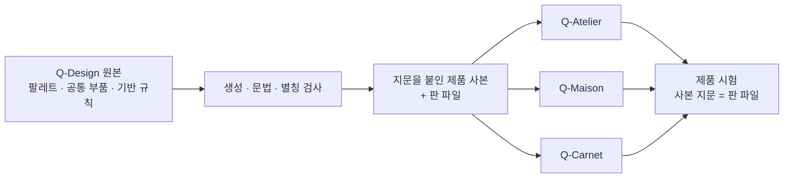

# 10장 · 지키는 규칙

이 장은 디자인이 시간이 지나도 무너지지 않게 하는 장치를 정합니다. 무엇을 지켜야 하는가, 디자인 일이 들어와서 운영에 나갈 때까지 어떤 걸음을 밟는가, 기반 규칙(서체 · 간격 · 로그인 · 셸 · 상태 · 인쇄 · 오프라인)의 원본이 어디 있고 어떻게 바꾸는가, 어떤 검사가 그것을 지키는가를 적습니다.
끝에는 이 시스템을 다른 사이트로 옮겨 쓰는 법을 둡니다.

합친 옛 문서: 09 규칙과 계약 · 10 옮겨 쓰기 · 35 기반 규칙

---

## 적어 둔 규칙과 실패하는 규칙

토큰과 색은 취향이지만, 이 장의 장치들은 **디자인이 시간이 지나도 안 무너지게** 합니다.
원본은 이것들을 문서가 아니라 **시험**으로 두었습니다. 문서는 안 읽히지만 시험은 실패하기 때문입니다.

원본에서 실제로 일어난 일들입니다.

- 색을 두 곳(`tokens.ts` · `globals.css`)에 적어 두었더니 한쪽만 고쳐져 라이트 모드에서 금색이 두 가지가 되었습니다
- 주석에 「4.5:1 통과」라 적어 두었는데 실제로는 4.45 였습니다
- 「하프스텝은 미세조정용」이라 적어 두었는데 실제로는 표류값이 되어 한 화면에 글자 크기가 12종이 되었습니다
- 「우회 함수는 둘뿐」이라 적어 두었는데 셋이었습니다

> **적어 둔 규칙은 지켜지지 않습니다. 실패하는 규칙만 지켜집니다.**
> 계약은 값이 아니라 **되돌아가는 것**을 막습니다. 고친 것이 «다음 사람이 다시 쓸 수 있는» 상태로 남아 있으면 아직 규칙이 아닙니다.

---

## 무엇을 지켜야 하는가

대상은 아뜰리에, 메종, 카르넷의 화면 표현입니다. 업무 판단식, 권한, 인증, 데이터 계산은 제품에서 관리합니다.
디자인 원본은 Q-Design 에서 관리하고, 제품에는 검사할 수 있는 사본을 배포합니다.

| 분야 | 반드시 관리할 인자 | 규칙 |
| --- | --- | --- |
| 화면 바탕 | canvas, surface, raised, 입력 면, 대비, 테마 초기값 | 의미 이름으로 연결하고 사용자 테마에 따라 함께 바뀝니다. |
| 배경 장식 | 이미지, 리본, 색, 투명도, 폭, 위치, 흐림, 동작 시간, 이징 | 내용의 가독성을 우선합니다. 장식은 입력을 가로채지 않고 동작 감소 설정을 따릅니다. |
| 제품 식별 | 공식 마크, 금속색, 비율, 보호 여백, 크기, 대체 텍스트 | 공식 자산을 유지합니다. 제품색과 상태색의 역할을 섞지 않습니다. |
| 서체 | UI · 숫자 · 브랜드 계열, 글꼴 로드, fallback, 크기, 굵기, 자간, 줄높이 | 일반 UI 는 Pretendard, 식별 숫자는 공통 mono 를 씁니다. 장식용 제목의 별도 서체는 지정된 위치에만 씁니다. |
| 밀도 · 간격 | 기준 단위, 내부 간격, 구역 간격, 본문 여백, 행 높이 | 간격 사다리를 공유합니다. 현장 입력 같은 기능상의 차이는 명시한 변형입니다. |
| 레이아웃 | 너비, 최대폭, 최소폭, 열, 정렬, wrap, overflow, breakpoint | 모바일에서 읽기 순서를 유지하고 페이지 전체 가로 넘침을 만들지 않습니다. 데이터 표의 내부 스크롤은 따로 봅니다. |
| 인증 | 배경, 브랜드 영역, 폼 폭, 제목, 설명, 카드, 입력, 저장 계정, 행동, 테마 전환 | 로그인 · 가입 · 초대 · 비밀번호 찾기 · 재설정은 같은 인증 기반을 씁니다. |
| 앱 셸 | 머리 높이, 탐색 폭, 고정 오프셋, 본문 시작, 모바일 메뉴, 스크롤 여백 | 탐색과 제목이 본문을 가리지 않고 키보드 초점이 고정 영역 아래에 숨지 않습니다. |
| 행동 | 크기, padding, radius, 레이블, 아이콘, hover, active, pending, disabled | 같은 역할의 행동은 같은 기본값을 씁니다. 누르는 영역은 일반 터치 44px 이상입니다. |
| 입력 | 높이, 내부 간격, 글자 크기, placeholder, focus, 오류, 읽기 전용, disabled | 레이블과 설명을 연결합니다. 카르넷 현장 입력은 56px 변형을 씁니다. |
| 선택 | checkbox, radio, switch, chip, select, calendar, 선택 · 비활성 상태 | 그림 크기와 누르는 영역을 나눕니다. 상태는 색 말고도 알 수 있어야 합니다. |
| 목록 · 표 | 검색 띠, 필터, 열 제목, 셀 간격, 정렬, 선택, 빈 상태, 페이지 이동 | 제목 · 메타 · 숫자의 위계를 공유합니다. 표 밀도와 조작부 높이를 함께 관리합니다. |
| 카드 · 구역 | 제목, 설명, 면, 경계, 간격, 반경, 행동 위치 | 구역 구분에 필요한 면과 선만 씁니다. 같은 구조를 다른 그림자로 꾸미지 않습니다. |
| 오버레이 | 배경막, 표면, 경계, 반경, 폭, 여백, 층, 스크롤, 진입 · 퇴장 | 초점 진입 · 순환 · 복귀와 최상위 Escape 닫기를 보장합니다. 긴 내용과 마지막 행동까지 닿을 수 있어야 합니다. |
| 상태 · 피드백 | 안내, 오류, 성공, 토스트, badge, 진행률, skeleton | 의미 색을 공유하고 글을 함께 둡니다. 실패를 빈 데이터로 바꾸지 않습니다. |
| 차트 | 시리즈, 축, 기준선, 점, 굵기, 투명도, 라벨, 범례 | 표현은 중앙 인자를 쓰고 좌표 · 값 · 집계 · 판정은 제품 계산을 유지합니다. |
| 오류 · 접근 제한 | 오류 코드, 제목, 설명, 복구 행동, 최대폭, 배경 | 전역 오류, 404, 권한 없음, 오프라인은 같은 상태 화면 원칙을 따릅니다. 독립 HTML 도 같은 기준으로 봅니다. |
| 동작 | 속성, 지속 시간, 지연, 반복, 이징, transform, reduced-motion | 정보를 이해하는 데 필요한 동작만 남깁니다. 장식 움직임은 감소 설정에서 멈춥니다. |
| 상호작용 | pointer, hover, focus-visible, selected, dragging, loading | CSS 상태와 실제 조작 상태를 맞춥니다. CSS 값 검사만으로 동작을 통과시키지 않습니다. |
| 레이어 | 고정 머리, 메뉴, 모달, tooltip, toast, blocking | 공통 층 순서를 지키고 겹친 오버레이의 닫기 · 스크롤 소유권을 나눕니다. |
| 출력 | 용지, 여백, 글자, 경계, 페이지 나눔, 인쇄 테마, 바코드 | 화면 인자를 바꿔도 기계 판독과 법정 기록 양식이 변하지 않게 따로 검증합니다. |
| 자산 · SVG | viewBox, fill, stroke, opacity, font, URL 이미지, 마스크 | CSS 색이 들어갈 수 없는 이미지 경계를 확인합니다. SVG data URL 이 바깥 변수를 상속한다고 가정하지 않습니다. |

단추 · 입력의 역할별 높이(44 · 36 · 56)는 [4장](04-space-layout.md)의 터치 타겟에, 모서리 · 그림자 · 움직임은 [5장](05-shape-elevation-motion.md)에 있습니다.

---

## 고치고 키우는 흐름

2026-10-22 에 적었습니다. 그전까지 이 흐름은 작업 기록과 사람의 기억에만 있었습니다.

디자인 일은 세 곳에서 들어옵니다. 오너의 지적, 감사(`node tools/check.mjs --products`)의 빨강, 운영 화면을 직접 열어 본 점검입니다.
들어온 일은 먼저 갈래를 정합니다. 갈래가 밟을 걸음을 정합니다.

| 갈래 | 알아보는 법 | 시안 · 오너 선택 |
| --- | --- | --- |
| 고침 | 보이는 모양은 그대로이고 결함만 없어집니다. 넘침, 겹침, 대비 미달, 누르는 자리 부족, 초점 잃음, 한글 자간 | 없이 바로 합니다 |
| 바꿈 | 사람이 보면 달라졌다고 알아챕니다. 색, 크기, 배치, 구역 짜임, 새 장치, 화면 글의 문장 | 시안 2~3개를 실제 화면에 입혀 보이고 오너가 고릅니다. 화면 글은 바꿀 문장 목록이 시안입니다 |
| 새 부품 · 새 화면 꼴 | [6장 역할별 등록부](06-components.md)에 없는 것 | 역할을 먼저 등록하고, 그다음은 «바꿈» 과 같습니다 |

애매하면 «바꿈» 으로 봅니다. «고침» 으로 시작했는데 모양이 바뀌기 시작하면 거기서 멈추고 시안으로 돌아갑니다.

### 걸음

| # | 걸음 | 끝났다고 보는 기준 |
| --- | --- | --- |
| 1 | 지금 화면을 잽니다 | 고칠 화면을 PC 1366 · 폰 412 · 375, 밝은 테마 · 어두운 테마로 열어 본 기록. 결함이면 재현한 숫자(넘친 px, 대비 값) |
| 2 | 시안을 만듭니다 (바꿈 · 새 부품) | 실제 화면에 입혀 찍은 그림 2~3장을 한 판에 놓고 추천 하나를 밝힙니다 |
| 3 | 오너가 고릅니다 (바꿈 · 새 부품) | 고른 안과 날짜를 작업 기록에 적습니다 |
| 4 | 정본을 먼저 고칩니다 | Q-Design 의 원본([6장 «원본과 책임»](06-components.md))만 고칩니다. 제품의 사본과 공용 부품 파일은 고치지 않습니다 |
| 5 | 검사 하나를 돌립니다 | `node tools/check.mjs` 초록. 새 규칙이면 실패하는 시험을 하나 더하고, 일부러 깨뜨려 빨강을 본 뒤 되돌립니다 |
| 6 | 내보냅니다 | `node tools/extract-all.mjs --sync --only=…` 뒤 `node tools/status.mjs` 에서 그 제품이 최신이고 «부품 N/N» 입니다 |
| 7 | 제품을 맞춥니다 | 제품 화면의 쓰는 자리를 고치고 제품 시험이 초록입니다 |
| 8 | 다시 잽니다 | 1번과 같은 폭 · 테마에 키보드 조작까지. 페이지 가로 넘침 0. 정적 검사의 초록은 이 걸음을 대신하지 않습니다 |
| 9 | 커밋합니다 | Q-Design 과 제품을 따로 커밋합니다. 커밋 전 `git diff --cached --stat` 으로 다른 작업의 파일이 섞이지 않았는지 봅니다 |
| 10 | 올립니다 | 제품 main 은 곧 운영이므로 오너 승인 뒤에만 올립니다. Q-Design 은 운영이 아니므로 커밋과 함께 올립니다 |
| 11 | 운영에서 잽니다 | 배포가 끝난 뒤 운영 화면을 1번의 폭으로 다시 열어 봅니다 |
| 12 | 기록합니다 | [작업 기록](SESSION_LOG.md) 맨 위에 한 덩이. 정본 장의 규칙이 바뀌었으면 그 장도 고칩니다 |

«고침» 은 2 · 3 을 건너뜁니다. 나머지 걸음은 갈래와 상관없이 다 밟습니다. 명령의 자세한 쓰임은 [6장 «바꾸는 절차»](06-components.md)에 있습니다.

### 정본을 건너뛰지 않습니다

공용 부품 파일(`patterns/component-implementations.json` 에 적은 34개)과 사본은 제품에서 고치지 않습니다.
제품의 판 파일이 파일마다 확인값을 들고 있어, 제품에서 고치면 그 제품의 판 시험이 빨개집니다.
내보내기도 정본과도, 판 파일에 적힌 값과도 다른 제품 파일을 만나면 덮지 않고 멈춥니다.

급해서 제품에서 먼저 고쳤다면 그날 안에 정본으로 받습니다. 제품에서 커밋한 뒤 Q-Design 에서 돌립니다.

```powershell
node tools/build-component-implementations.mjs --adopt --only=Q-Atelier
node tools/extract-all.mjs --sync --only=Q-Atelier
```

받기는 제품의 커밋본만 받습니다. 작업본이 커밋본과 다르거나, 그 사이 정본도 바뀌었으면 거절합니다. 그때는 손으로 합칩니다.

2026-10-21 에 이 길이 열려 있었습니다. Q-Atelier 커밋 셋이 `lib/design/components.tsx` 를 제품에서 고쳤고, 그 상태로 내보냈다면 운영에 나간 세 고침이 옛 정본으로 소리 없이 덮였을 것입니다.

### 할 일은 어디서 보나

- 도구가 아는 것은 명령이 답합니다. `node tools/check.mjs`(늘 초록), `node tools/check.mjs --products`(제품 감사의 빨강), `node tools/status.mjs`(제품별 판 뒤처짐).
  이 셋의 결과는 따로 옮겨 적지 않습니다. 옮겨 적으면 낡습니다.
- 도구가 모르는 것만 [작업 기록](SESSION_LOG.md) 맨 위 «남은 일» 한 덩이에 둡니다. 문서와 코드가 다른 곳, 오너 결정을 기다리는 것, 다음 바퀴의 시안 거리입니다.
  끝낸 줄은 지우고 그날의 기록으로 옮깁니다.
- 한 바퀴는 «고침» 갈래를 먼저 끝내고, «바꿈» 갈래는 시안부터 엽니다.

---

## 기반 규칙의 원본과 바꾸는 길

### 원본

| 층 | 원본 | 전달 방법 |
| --- | --- | --- |
| 팔레트 · 테마 | `patterns/palette-overrides.json`, `patterns/palette-mappings.json` | 제품별 CSS 변수 이름과 형식으로 생성 |
| 공통 조작부 | `patterns/components.css` | 세 제품에 같은 본문 복사 |
| 공통 기반 인자 | `patterns/foundation.css` | 제품별 기반 규칙 앞에 결합 |
| 배경 · 인증 · 셸 · 법적 안내 · 인쇄 | `patterns/foundation/*.css` | 원래 선택자와 미디어 순서를 보존해 제품별 생성 |
| 메종 유틸리티 | `patterns/foundation/maison-tailwind.ts` | TypeScript 사본을 Tailwind 설정이 가져옴 |
| 아뜰리에 인라인 스케일 | 제품 `lib/design/q-design-scale.ts` | 숫자가 필요한 업무 코드는 보존하고 UI 표현은 중앙 CSS 변수를 읽음 |
| 아뜰리에 JS · SVG 수치와 반응형 기준 | `source/design/atelier-runtime.ts` | 제품 수치 사본과 CSS 미디어 조건을 같은 설정에서 생성. 측정 좌표와 업무 계산은 보존 |
| 공통 업무 아이콘 | `patterns/react-icon.tsx`, `patterns/components.css` | 생성 모듈과 기본 크기 · 정렬 변수. 명시한 크기와 유틸리티 클래스가 우선 |
| 아뜰리에 개별 표현 인자 | `patterns/foundation/atelier-values.css`, `patterns/foundation/atelier-core-values.css` | 안정적인 변수 이름으로 인라인 표현을 연결. 원래 자리와 기존 값은 `source/style-adapters/` 에 기록 |
| 카르넷 유틸리티 | `patterns/foundation/carnet-theme.css` | Tailwind 테마를 중앙 사본으로 가져와 공통 간격 · 서체 · 크기 · 반경을 읽음 |
| 메종 인쇄 · 문서 인자 | `patterns/foundation/maison-print.ts`, `patterns/foundation/maison-print-styles.tsx` | 물리 단위와 기존 기본값을 보존한 TypeScript 사본 |
| 카르넷 런타임 색상 | `dist/q-design.palette.carnet.ts` | PWA · 회사 색상 대비 계산에서 같은 생성 팔레트를 씀 |
| 아뜰리에 오프라인 | `patterns/foundation/atelier-offline.html`, `patterns/foundation/offline.css` | CSS 와 팔레트를 HTML 안에 묶고 내용 지문을 워커 캐시 판에 연결 |
| 공식 CI · 바코드 · 인쇄 규격 | 승인된 자산과 해당 출력 계약 | 별도 경계로 기록하고 비율 · 기계 판독 · 물리 크기 보존 |

### 바꾸는 길

`tools/build-foundation.mjs` 는 공유 인자와 각 제품의 선택자 규칙을 합치고, 문법 · 빈 토큰 · 정의 안 된 별칭 · 별칭 순환을 검사합니다.
`tools/sync.mjs` 는 본문 지문을 붙여 정해진 제품에 복사하고, 제품마다 판 파일(`q-design.version.json`)을 씁니다. 판 파일에는 조각마다 본문 지문과 그 내용이 Q-Design 에 들어온 커밋 · 날짜가 적힙니다.
제품의 생성 사본을 직접 고치지 않습니다. 파일이 있는 것과 실제 앱이 그것을 읽는 것은 따로 확인합니다.



```powershell
node tools/extract-all.mjs            # 산출물을 전부 다시 만듭니다(Q-Design 안만 씁니다)
node tools/extract-all.mjs --sync     # 만든 뒤 제품으로 내보내고, 정말 같아졌는지 다시 대조합니다
node tools/extract-all.mjs --check    # 검사 하나(node tools/check.mjs)를 돌립니다. 아무것도 쓰지 않습니다
node tools/check.mjs --products       # 손으로 돌리는 제품 감사(제품 코드를 훑습니다)
node tools/status.mjs                 # 제품마다 받은 판 · 뒤처짐 · 손댄 사본을 한 줄씩 봅니다
```

제품 저장소에 쓰는 길은 `--sync` 하나입니다. 제품을 고르려면 `--only=Q-Atelier,Q-Works,Q-Forge` 처럼 씁니다(Q-Works 는 메종, Q-Forge 는 카르넷의 폴더 이름입니다).

전체 추출은 커밋된 아뜰리에 원본을 씁니다. 엔진 증빙과 잠금 파일은 UI 변경을 위해 고치지 않습니다.
원본 토큰(`tokens.ts`)은 2026-10-26 에 엔진 지문에서 빠졌습니다(Q-Atelier f5d7d14a). 고쳐도 엔진 근거가 «다시 해야 함» 으로 바뀌지 않습니다.
원본 추출 · 제품 사본 · 화면 검사 · 전체 검사 결과는 구분해서 기록합니다.

### 오프라인 화면의 캐시

오프라인 화면은 서버 파일만 갱신해도 설치된 PWA 의 캐시가 남을 수 있습니다. 그래서 HTML 내용에서 만든 캐시 판 파일을 서비스 워커가 가져오고,
등록할 때 `updateViaCache: 'none'` 으로 워커와 가져온 파일의 변경을 확인합니다.
이 동작은 [MDN 의 서비스 워커 캐시 갱신 설명](https://developer.mozilla.org/en-US/docs/Web/API/ServiceWorkerRegistration/updateViaCache)에 따릅니다.

---

## 어떤 검사가 지키는가

### Q-Design 안의 검사

검사는 `node tools/check.mjs` 하나입니다(`extract-all --check` 도 이것을 부릅니다). 아무것도 쓰지 않고, 몇 초 안에 끝납니다.

**늘 초록으로 둡니다.** 빨강이면 그날 고치거나 그 걸음을 지웁니다. «원래 빨강» 을 두지 않습니다. 시끄러운 검사는 없는 검사와 같기 때문입니다.
정본과 사본이 «언제 내보낼지 정해진» 채로 다르면 `tools/sync-parts.mjs` 의 `PENDING` 에 조각 · 기한 · 까닭을 적습니다. 검사는 그 자리를 「차례 기다림」 으로 알리고 실패로 세지 않습니다. 내보내서 같아지면 검사가 실패하며 그 줄을 지우라고 알립니다.

| 무리 | 보는 것 |
|---|---|
| 원본 | `source/` 가 원본 저장소의 **커밋된** 내용과 같은가(`refresh-source --check`) |
| 재현 | 만들기 도구마다 다시 만들어 저장본과 바이트로 대조합니다(줄바꿈은 LF 로 맞춘 뒤). 토큰 · 문서 토큰 · 종이 문서 v8 · 차림표 · 목록 · 뼈대 · 계단 · 팔레트 · 기반 · 아이콘 · 글꼴 등 26걸음 |
| 대비 | `docs/02-color.md` 의 대비표가 산출물과 같은가. 문서 토큰 두 벌은 만들 때 종이 위 AA 를 함께 봅니다 |
| 문자 | 긴 줄표 같은 금지 문자(`check-chars`) |
| 자간 | 정본 화면 CSS 에서 자간 · 대문자를 거는 자리마다 `[data-hangul]` 풀림 짝이 있는가. `var()` 로 오는 자간도 변수를 따라가 풉니다(`check-hangul-canon`) |
| 사본 | 제품에 나간 조각 69곳 · 부품 구현 · 업무 아이콘 · 앱 아이콘 · 모노 글꼴 사본이 정본과 같은가. 앱(안드로이드 · iOS)의 오프라인 화면 · 글꼴 · 색 · 시작 화면 · 알림 사본은 재현 걸음이 함께 대조합니다 |
| 시험 | `tools/*.test.mjs` 전부. 제품 파일 대신 정본이나 고정 자료(`tools/fixtures/`, 출처는 폴더마다 `SOURCE.md`)를 읽습니다 |

**검사 안에서 제품 저장소를 읽는 일은 둘뿐입니다.** 원본 받기(커밋된 내용만)와 사본 대조입니다(2026-10-16 웹 제품, 10-17 앱 저장소까지 추적기로 확인).
라이브러리는 Q-Design 자기 `package.json` 에 판 번호를 고정해 둡니다(2026-10-20). 처음 받으면 `npm ci` 로 깝니다.
예전에는 도구 30개 파일의 35곳이 typescript · postcss · vite · react · prettier · playwright 같은 라이브러리를 제품의 `node_modules` 에서 빌려 썼습니다(Q-Atelier 26 · Q-Works 9).
이제 검사와 감사를 돌리는 동안 제품 `node_modules` 를 여는 일은 0번입니다(파일 읽기와 모듈 찾기를 모두 적는 추적기로 확인).

일부러 제품 것을 쓰는 자리는 둘뿐입니다. 빌림이 아니라 제품 결을 지키는 것입니다.

- 작업대(`build-component-workbench`)가 제품 부품을 그 제품의 react · tailwind 로 그리는 곳
- 문구 도구(`copy-spacing`)가 제품 코드를 고쳐 쓸 때 그 제품의 정렬기(prettier)로 맞추는 곳

판 번호는 Q-Works 가 쓰는 판에 맞췄습니다. 앱 아이콘 렌더러(playwright 1.62.1 · sharp 0.34.5)만은 승인된 아이콘을 바이트까지 재현하는 고정 판입니다(`tools/app-icon-runtime.mjs`).
판을 올리면 검사를 돌려 산출물이 바이트까지 그대로인지 봅니다.

제품 코드 전체를 훑어 «쓰이는가 · 지켜지는가» 를 보는 일은 감사로 뺐습니다. 감사는 빨강이 나와도 검사를 막지 않고, 제품을 고치는 날 함께 봅니다.

| `node tools/check.mjs --products` | 보는 것 |
|---|---|
| 사본을 부르는 곳 | 제품 코드가 받은 사본을 실제로 부르는가(`sync --consumers`) |
| 화면 문구 · 업무 아이콘 | 제품 코드 전체에 문구 규칙이 적용됐는가 · 화면이 가져오는 아이콘마다 정본 사본이 있는가 |
| 앱 아이콘 | 제품 코드의 판 번호 주소 · 설치 앱 설명 · 붓 Q · 상단 바 색 |
| 앱 색 파일 | 앱이 직접 쓰는 색 파일(안드로이드 `colors.xml` 낮 · 밤, iOS `Palette.swift`)이 중앙 색 이름을 부르는가(`build-native-offline --check --contracts`). 내보낼 때(`--write`)는 늘 함께 봅니다 |
| 한글 자간 · 말투 | 제품 소스에 글자로 박힌 한글이 라틴 자간 자리에 있는가 · 화면 글의 종결 |
| 다 뽑았나 · 계단 | 제품의 색 · 파일이 정본에 다 담겼나 · 세 제품이 쓰는 샴페인 칸이 정본 계단과 같은가 |

브라우저로 제품 화면을 띄워 증명하는 검사는 Q-Design 에 두지 않습니다(오너 결정 2026-10-16).

**도구 없이 사람이 지키는 규칙.** 아래 셋은 지키던 도구가 1단계에서 빠졌고, 다시 만들지 않기로 했습니다(장부형 검사는 다시 만들지 않습니다). 바꾸는 사람이 직접 확인합니다.

- 글꼴이 CDN 없이 실제로 붙는가. 지금 검사는 받아 둔 글꼴 캐시가 온전한지까지만 봅니다(`fetch-fonts --offline`)
- 스타일 감사에서 미검토가 남으면 실패한다는 판정 원칙(옛 `--strict`)
- 새 공개 부품은 역할을 먼저 등록한다는 규칙([6장](06-components.md)). `source/component-*.json` 을 읽는 도구는 지금 없습니다

### 계약 시험

아래 계약은 원본 저장소 Q-Atelier 의 `lib/design/` 에 있는 시험(vitest)입니다. 제품의 시험 실행에서 돕니다.
Q-Design 은 그 사본을 `source/contracts/` 에 둡니다. 손으로 베낀 것이 아니라 `node tools/refresh-source.mjs` 가 원본 저장소의 **커밋된** 내용에서 받아옵니다(㉖).
아래 목록의 시험 파일은 모두 Q-Atelier `lib/design/` 에 있습니다. `source/contracts/` 는 그 사본이고(이 목록 밖의 계약도 함께 있습니다), 사본이 낡았는지는 ㉖ 이 봅니다.

#### 색

**① 대비: 텍스트 토큰이 «모든» 표면 위에서 AA** · `contrast.test.ts`

```
표면 3종(bg · surface · surface2) × 텍스트 8종      = 24가지 조합 전부 4.5:1 이상
표면 3종               × 상태색 7종  × 2테마 = 42가지 + 배지 실조건 14가지
```

> 색을 고칠 때는 **가장 어려운 표면**(대개 surface2)을 기준으로 잡을 것.
> bg 하나만 보고 맞추면 카드 위에서 조용히 미달한다. (실패 메시지)

인쇄 팔레트도 같은 검사를 받습니다. 심사원은 출력물을 읽기 때문입니다.
**배지는 순수 표면 위에 놓이지 않습니다.** `Tag` primary 가 `alpha(색, 0.1)` 바탕을 깔기 때문에 글자가 놓이는 바닥은 «표면 + 그 색 10%» 이고 대비가 더 낮습니다.
계약은 그 **실조건까지** 잽니다. 값과 표는 [2장](02-color.md)에 있습니다.

**② 팔레트 사본 동기화** · `contrast.test.ts` 의 «팔레트 사본 동기화»
같은 색이 TS 상수와 CSS 변수 두 곳에 있습니다. 계약이 값을 대조합니다. 한쪽만 고치면 실패합니다.

**③ 다크 · 라이트 변수 집합 동등성** · `theme-parity.test.ts`
두 테마가 **정확히 같은 변수 이름 집합**을 정의해야 합니다. 라이트에만 없는 변수가 있으면 그 자리는 다크 값을 물려받아 조용히 깨집니다.

**④ 새 hex 리터럴 동결** · `no-new-hex.test.ts`
소스 전체의 raw hex 사용량을 **326개로 동결**합니다. 넘으면 실패하고, 줄이면 기준을 낮춰 다시 동결합니다.
hex 를 정의해도 되는 파일은 `tokens.ts` 와, 지문 계약이 따로 지키는 Q-Design 생성물 `q-design.doc.ts` 둘입니다.

**⑤ 액센트 면 위 흰 글자 금지** · `on-accent-contract.test.ts`
부품에 `color: '#fff'` · `'#ffffff'` · `'white'` 리터럴이 **0개**여야 합니다.
액센트는 테마에 따라 밝기가 뒤집히므로, 흰 글자를 박으면 한쪽 테마에서 안 읽힙니다.
면제 목록이 있는데 **면제가 낡지 않았는지도 함께 검사합니다.**

#### 스케일

**⑥ raw 스케일 동결** · `no-raw-scale.test.ts`

| 대상 | 동결값 | 대신 쓸 것 |
|---|---:|---|
| raw `fontSize` | 66 | `TYPE.*` / `typeStyle()` |
| raw `lineHeight` | 52 | `LH.*` |
| raw spacing (padding/margin/gap) | 1448 | `S[*]` |
| raw `zIndex` | 47 | `Z.*` |
| raw `var(--qa-state-*)` | **0** | `STATE.*` |

상태색만 0 인 것은, 이미 완전히 토큰화되었으므로 **되돌아가는 것을 금지**한다는 뜻입니다.
총량만 보는 동결은 «정작 충돌하는 자리» 에 새 숫자가 생겨도 못 잡습니다. 그래서 `z-ladder-contract.test.ts` 가 떠 있는 층 파일(전역 검색 · 사이드바 등)만 골라 raw `zIndex` 를 0 으로 봅니다.

**⑦ 화면 셸을 좁히는 것은 현장 모드뿐** · `page-shell-contract.test.ts`
2026-10-27 오너 결정 «3» 부터 상세 · 폼은 `PageShell` 로 꽉 채우고 칸 격자로 넓이를 받습니다. 계약은 600px 이상으로 좁힌 화면 셸 가운데
`LAYOUT.mobile`(520) 이 아닌 것을 막고, `LAYOUT` 에 `mobile` 말고 다른 키가 생기면 멈춥니다. 좁힌 현장 셸은 **가운데로 놓는지**까지 검사합니다.
`maxWidth` 만 주고 `margin: 0 auto` 를 빠뜨리면 왼쪽에 붙습니다. 통일성은 «눈으로 훑어» 지키지 않고 눈금을 하나만 두고 거기서 고르게 해서 지킵니다.

**⑧ 줄간격 사다리 TS ↔ CSS 동기화** · `lh-css-sync.test.ts`

1. TS `LH` 와 CSS `--qa-lh-*` 의 **키 집합이 같은가**
2. 같은 키의 **값이 정확히 같은가**
3. 전역 CSS 에 raw `line-height` 가 **없는가** (전부 변수인가)

세 번째가 요점입니다. 값을 맞춰도 새 raw 가 들어오면 사다리가 다시 갈라집니다.

**⑨ 승격 토큰의 1:1 대응** · `tokens-promoted.test.ts`
`STATE` 7색이 CSS 변수와 1:1 인가, `OVERLAY` · `ELEVATION` 이 테마 인지 변수를 가리키는가, **`Z` 가 단조 증가하는가**, `S` 하프스텝이 2px 단위로 정확한가.

#### 글자

**⑩ 한글 라벨에 자간을 주지 않는다** · `label-tracking-contract.test.ts`

1부(`lib/design/components.tsx` 한 파일)

1. `uppercase` 근처에 raw `letterSpacing` 리터럴이 **0개**
2. uppercase 를 쓰는 부품이 **여전히 있는가** (계약이 헛돌지 않는가)
3. **검출기 자체가 raw 리터럴을 잡는가** (가드가 빈 그물이 아닌가)

2부(2026-10-22 · `app/` · `components/` 의 모든 .tsx)

4. 0.3px 넘는 양수 자간(`var(--qd-…)` 토큰 · `QDText.tracking.*` 포함)이 걸린 **한글 글귀가 0개**.
   글귀는 함수가 돌려준 객체의 속성 · 부품을 부르는 곳이 넘긴 props · 배열 원소 · 매개변수 타입까지 따라간다.
5. 끝까지 정할 수 없는 «모름» 자리가 **파일별 기준선(`UNKNOWN_BASELINE`)과 같은가**.
   줄었으면 기준선을 줄이고, 새 파일에 생겼으면 `labelTracking(글귀, 원래값)` 으로 감싼다. 실패 메시지가 붙여 넣을 기준선을 보여 준다.
6. **검출기가 가짜 파일에서 위의 갈래를 하나씩 잡는가**, 감싼 것 · 라틴 · 숫자는 지나가는가

2번 · 3번 · 6번이 중요합니다. 검사 대상이 사라지거나 검출기가 눈을 감으면 계약은 «언제나 통과» 가 되어 조용히 죽습니다.
1부만 있던 때가 그랬습니다. `"var(--qd-…)"` 꼴의 자간을 읽지 못해 운영 화면의 한글 자간을 그냥 지나갔습니다.

**⑪ Tag 높이를 정하는 쪽 고정** · `tag-metrics.test.ts`
「무엇이 배지 높이를 정하는가」를 잠급니다.

- 크기별로 정하는 쪽이 고정 (`xs` · `sm` = minHeight · `md` = lineHeight)
- **md 의 여유가 0.2px** 임을 명시. 이 여유가 사라지면 정하는 쪽이 뒤집힙니다
- `sm` 도 여유가 1.2px 뿐입니다
- `LH.snug` 를 올리면 **세 크기 모두** lineHeight 가 정하는 쪽으로 넘어갑니다

이 계약의 가치는 값을 지키는 데 있지 않고, **보이지 않는 사슬을 보이게 만든 데** 있습니다.

#### 배치

**⑫ Grid: 규칙이 인라인을 이긴다** · `grid-rules.test.tsx`

- `cols={4}` 면 `@media (min-width:1024px)` 규칙이 있고 **인라인 `grid-template-columns` 가 없어야** 합니다
- 기본 템플릿 규칙이 **맨 앞**에 와서 뒤의 breakpoint 규칙이 덮어쓸 수 있어야 합니다
- 규칙이 없으면(cols · responsive 미지정) 인라인입니다
- **호출부가 명시적으로 준 `gridTemplateColumns` 는 그대로 존중**합니다

인라인은 클래스를 이기므로, 둘 다 내면 미디어 쿼리가 한 번도 적용되지 않습니다.

**⑬ sticky 는 여백을 계산해서 뺀다** · `sticky-inset.test.ts`

- 상단 밴드는 padding 과 무관하게 화면 맨 위에 붙는가
- 데스크톱 저장 바는 화면 밑변에 붙는가 (아래 틈이 없는가)
- 모바일 저장 바는 하단 네비 «바로 위» 인가
- safe-area 가 섞인 값도 `calc` 로 그대로 넘어가는가
- **리터럴 0 이 아니라 계산식을 쓰는가**
- `main` 의 padding 이 **한 곳(`MAIN_PADDING`)에서 나오는가**

배경은 [4장](04-space-layout.md)의 앱 셸 구조에 있습니다.

**⑭ Bx 는 모든 사용처가 padding 을 준다** · `bx-padding.test.ts`
그리고 **`Bx` 가 여전히 기본 padding 을 갖지 않는지**도 검사합니다. 계약의 전제가 무너지는 것을 막는 장치입니다.
`Alert` 의 기본 `marginBottom` 도 여기서 함께 잠급니다.

#### 상황별 규칙

**⑮ 현장 모드에는 키보드를 띄우는 입력이 없다** · `field-no-keyboard.test.ts`
장갑 낀 손을 위한 규칙입니다.

- `<textarea>` 가 **없습니다** (장갑 낀 손은 문장을 칠 수 없습니다)
- `<input>` 은 **누르거나**(button · checkbox · file) **고르거나**(date) **스캔**(`inputMode="none"`)만 합니다
- 검사 대상 파일을 실제로 찾았는가 (계약이 헛돌지 않는가)

디자인 시스템이 «사용 상황» 까지 계약으로 담은 예입니다. 현장 모드의 셸 폭이 패드에서 760px 로 넓어지는 것도 같은 까닭입니다([4장](04-space-layout.md)).

**⑯ 마크다운 기호가 화면에 새지 않는다** · `inline-strong.test.tsx`
AI 가 생성한 글을 화면에 그릴 때 `**굵게**` 만 `<strong>` 으로 바꾸고 나머지(`#`, `-`)는 해석하지 않습니다.
짝이 안 맞는 `**` 는 손대지 않습니다. **서버 쪽 프롬프트가 평문을 요구하는지까지** 함께 검사합니다.

**⑰ 라디오 묶음 접근성** · `segmented-choice.test.tsx`
roving tabindex, 화살표 순환, 비활성 건너뛰기, Home/End, 전부 비활성일 때 `null` 반환(무한 루프 방지)까지 검사합니다.

**⑱ 전문가 포털도 같은 검사를 받는다** · `expert-contrast.test.ts` · `expert-type-scale.test.ts`
내부 앱의 대비 계약이 전문가 테마를 보지 않았을 때, 같은 실수가 전문가 테마에서 다시 나왔습니다. 테마가 하나 더 있으면 계약도 그 테마를 봐야 합니다.

#### 접근성

**⑲ Alert 은 색만으로 종류를 말하지 않는다** · `alert-not-color-only.test.tsx`
네 종류(오류 · 주의 · 성공 · 안내)를 구별하는 단서가 색뿐이면 색각 이상인 사람에게는 한 종류입니다.

- 네 종류 모두 `role` 이 있고, **급한 것은 `alert` · 알림은 `status`** 로 갈립니다
- 아이콘에 `aria-label` 이 있고 **네 이름이 서로 다릅니다**
- 아이콘은 `aria-hidden` 이 아닙니다 (제목 없이 쓰는 자리가 여기에 기댑니다)
- **색을 전부 지워도 네 종류가 서로 다릅니다**
- `role` 이 같은 둘(오류 vs 주의)도 색 없이 서로 다릅니다

마지막 두 줄이 이 계약의 핵심입니다. 「aria 를 붙였다」가 아니라 **색을 빼고도 구별되는가**를 직접 확인합니다.

**⑳ 초점 표시를 인라인으로 지우지 않는다** · `focus-visible-contract.test.ts`
`style={{ outline: 'none' }}` 을 **동결**합니다. 인라인은 클래스를 이기므로, 전역 `:focus-visible` 규칙이 있어도 그 자리만 초점이 사라집니다.

- 남아 있는 자리는 **이유가 코드에 적혀 있어야** 합니다 (프로그램이 초점을 주는 상자 등)
- 전역 CSS 의 초점 고리가 `input` · `textarea` · `select` 를 덮는가

두 번째가 요점입니다. 인라인을 다 걷어내도 새것이 또 생기므로, **전역 규칙 쪽을 넓혀** 표시가 남게 합니다([5장](05-shape-elevation-motion.md)의 포커스 표시).

#### 화면의 «말투»

색 · 크기 같은 값이 아니라, 화면이 사람에게 말을 거는 방식에 관한 규칙입니다. `screen-voice.test.ts` 한 파일에 셋이 들어 있습니다. 말투 전체는 [9장](09-voice.md)에 있습니다.

**㉑ 화면이 1인칭으로 말하지 않는다**
대시보드가 「우리 회사는 지금 N개 제품에 대해 총 M건의 변경이 진행되고 있고…」처럼 문장으로 요약하면 챗봇의 어법입니다.
**업무 도구는 값을 보여주고 읽는 것은 사람이 합니다.** 0 을 문장에 넣으면 정보가 아니라 빈칸을 메운 말이 됩니다(「총 0건의 변경이 진행되고 있고」).

**㉒ 같은 사실을 화면마다 다른 형식으로 적지 않는다**
의료기기 등급은 표시용 함수 `formatDeviceClass()` 를 거쳐 「2등급」으로 적습니다. raw 값(「2」)을 그대로 찍으면 한 화면만 숫자 하나로 뜹니다.
계약을 만들면 몰랐던 결함이 더 드러납니다. 그것이 계약을 만드는 까닭입니다.

**㉓ 세는 값과 나누는 값을 같은 변수로 쓰지 않는다**

```ts
const total = a + b + c || 1;   // ✗ 0 나눗셈을 막으려던 폴백이
                                //   표시에도 쓰여 화면이 「총 1건」이라 말한다
const total = a + b + c;        // ○ 표시에 쓰는 값
const denom = total || 1;       // ○ 나눗셈 전용
```

게다가 `total === 0` 이 참이 되지 않아 「평가 없음」 처리가 **한 번도 동작하지 않습니다.**

> 셋 다 **좁은 그물**입니다. `|| 1` 도 `device_class` 도 정당한 쓰임이 많아 전면 금지할 수 없습니다.
> 그래서 «합계처럼 보이는 이름» 과 «JSX children 자리» 만 봅니다. 넓게 잡으면 폼 value · 상태 콜백 · 개수 계산이 전부 걸립니다.
>
> 한글은 부분 문자열이 잘 겹칩니다. 「제가」로 찾으면 「**문**제가 발견되면」을 잡습니다.
> 앞 글자가 한글이면 제외하는 뒤돌아보기가 필요합니다.

#### 사본과 문서

**㉔ 나간 사본은 지문으로 대조한다** · `q-design-copy.test.ts` · `q-design-version.test.ts`
Q-Design 이 내보낸 조각은 받는 저장소 안에서 **손으로 고쳐질 수** 있습니다. 그러면 정본과 갈리는데 아무도 모릅니다.

- 파일 머리에 본문의 sha256 이 적혀 있고, **받는 쪽 시험이 다시 계산해서 대조**합니다
- 제품마다 판 파일(`q-design.version.json`)이 있고, 제품 시험이 «사본 지문 = 판 파일» 을 봅니다. 이 시험은 Q-Design 을 읽지 않습니다
- DOCX 빌더가 그 사본에서 색을 가져오는가 (값을 손으로 적지 않는가)

내보내는 쪽도 같은 것을 봅니다. `node tools/extract-all.mjs --sync` 는 쓰고 나서 **정말 같아졌는지 다시 확인**합니다. 쓰기가 성공했다는 것과 같아졌다는 것은 다릅니다.
「양쪽 모두 변경」이라고 적어 두는 것으로는 사본이 지켜지지 않습니다.

**㉕ 문서 산출물: 종이 위 대비와 글꼴 폴백** · `MedQraft Docs/templates/mqhtml.py` 의 `verify()`
대외 문서 생성기의 `verify()` 는 **실패하면 저장을 막습니다.**

| 검사 | 왜 |
|---|---|
| 종이 위 대비 | 팔레트의 뿌리가 다크 화면입니다. 화면 색을 그대로 종이에 쓰면 캡션 · 금색 라벨이 미달합니다 |
| 글꼴 폴백 | 한글 폴백 없이 `sans-serif` 로 떨어지면 Windows 에서 **굴림**이 됩니다. 한글 글꼴 목록에 `'Malgun Gothic'`, mono 목록에 `Consolas` 를 사이에 둡니다 |

- 대비는 **흰 종이와 양식 라벨 칸 바탕(`#F3F6FA`) 둘 다** 재고 나쁜 쪽으로 판정합니다
- «글자로 쓰인 색» 만 봅니다. 선 · 면 · 워터마크는 대비 대상이 아닙니다. 그래서 금색을 **장식(`GOLD`)과 글자(`GOLD_INK`)로 나눕니다**
- **「글꼴 지정을 하나도 못 찾으면 실패」** 도 함께 봅니다. 글꼴 값 안의 작은따옴표(`'Noto Sans KR'`)까지 경계로 넣으면 첫 따옴표에서 끊겨 아무것도 못 잡는 빈 그물이 되기 때문입니다

종이 문서의 색 · 글꼴 규격은 [8장](08-paper.md)에 있습니다.

#### 저장소 자신

**㉖ 사본과 문서의 숫자가 원본과 같은가**

| 도구 | 무엇을 지키나 |
|---|---|
| `node tools/refresh-source.mjs --check` | `source/` 가 원본 저장소의 **커밋된** 내용과 같은가 |
| `node tools/contrast-table.mjs --check` | `docs/02-color.md` 의 대비표가 산출물과 같은가 |

낡은 `source/` 에서 파생된 산출물은 실패가 아니라 **«낡은 것에서 정확히 파생된» 초록불**로 나옵니다. 그것이 가장 위험한 실패 형태입니다.
그래서 `refresh-source` 는 검사(`--check`)에서 맨 먼저 돌고, 만들기에서는 `source/` 를 읽는 추출기들보다 먼저 돕니다.

- 원본의 **작업 트리가 아니라 HEAD** 를 읽습니다. 다른 세션이 고치는 중인 파일이 사본에 얼어붙지 않게 합니다
- 지도가 설명하지 못하는 파일은 **«고아»** 로 보고합니다. 원본에서 지워졌는데 사본에만 남은 파일이 「진실」 행세를 하는 것을 막습니다
- `source/_ORIGIN.json` 에 **어느 커밋의 사본인지** 적힙니다

### 검사를 만들고 읽는 법

**일부러 깨뜨려 실패를 본 뒤 되돌리십시오.**
정규식 한 글자가 어긋나 아무것도 잡지 못하는 «빈 그물» 계약이 초록불을 내는 일이 실제로 있습니다.
검사 대상을 실제로 찾았는지, 검출기가 일부러 넣은 위반을 잡는지를 계약 안에 함께 둡니다(⑩ · ⑮ · ㉕).

**「가드가 있다」는 「전수를 본다」가 아닙니다.** 상태색이 대비 목록에 빠져 있거나(①), 테마 하나를 보지 않거나(⑱), 총량만 세는(⑥) 가드는 초록이어도 빈자리가 있습니다.

**있는 것과 쓰이는 것은 다릅니다.** 변수를 참조한다는 것만으로 올바른 역할과 실제 반영이 증명되지 않고, 파일이 있다는 것만으로 앱이 그것을 읽는다는 것이 증명되지 않습니다.
CSS 값 검사만으로 동작을 통과시키지 않고, 전체 화면을 보지 않은 채 목록만으로 모든 디자인이 끝났다고 표시하지 않습니다.

**동결(baseline) 방식이 특히 쓸 만합니다.**
「raw 값을 쓰지 마라」는 새 프로젝트에나 가능한 규칙입니다. 이미 수천 곳이 있는 프로젝트에서는 **지금 개수를 세어 동결하고, 넘으면 실패**시키는 편이 실용적입니다.

```
지금 1448곳 → BASELINE = 1448 → 넘으면 실패 → 줄이면 baseline 을 낮춰 다시 동결
```

한 번에 고치지 않아도 되고, **나빠지는 것만 막습니다.**

---

## 다른 사이트로 옮겨 쓰기

### 1단계 · 최소 (30분)

토큰 파일 하나만 걸면 색과 스케일이 전부 따라옵니다.

```html
<link rel="stylesheet" href="dist/q-design.tokens.css">
```

```css
body {
  background: var(--qa-bg);
  color: var(--qa-text);
  font-size: 14px;
  line-height: var(--qa-lh-relaxed);
  font-feature-settings: 'ss03', 'tnum';
  -webkit-font-smoothing: antialiased;
}
```

html 은 브라우저 기본 16px 그대로 둡니다(rem 기준. [3장](03-typography.md)).
글꼴은 `source/fonts/PretendardVariable.woff2` 를 함께 실어야 같은 얼굴이 됩니다(선언 전체는 `dist/q-design.fonts.css`).

```css
@font-face {
  font-family: 'Pretendard Variable';
  src: url('./PretendardVariable.woff2') format('woff2-variations');
  font-weight: 45 920;
  font-display: swap;
}
:root { --qa-font-pretendard: 'Pretendard Variable'; }
```

**이 단계만 해도 인상의 절반이 옵니다.** 크림색 글자와 샴페인 액센트가 핵심이기 때문입니다.

### 2단계 · 인상 (반나절)

값만으로는 「단조롭다」는 말을 듣습니다. **옮겨야 할 것은 장치입니다.**
아래 넷을 `dist/q-design.foundation.atelier.css` 에서 그대로 가져가십시오(원본은 `patterns/foundation/atelier.css`. 미디어 쿼리 값은 `dist` 쪽에 풀려 있습니다).

| 장치 | 무엇 |
|---|---|
| `.qa-card-lift` | 카드 호버의 **금테** (`0 0 0 1px` 금색 링) |
| `.qa-stagger` | 순차 등장 (35ms 간격, 9번째부터 고정) |
| `.qa-mag-divider` | 매거진 구분자 |
| `.qa-top-progress` | 상단 2px 금색 실선 |

그리고 **회색을 쓰지 마십시오.**

```css
/* 이렇게 하지 말고 */  background: #2a2a2a;
/* 이렇게 */           background: color-mix(in srgb, var(--qa-champagne) 4%, var(--qa-surface));
```

스크롤바 · 선택 영역 · 아바타 어디에도 순수 회색이 없다는 점이 이 시스템이 «비싸 보이는» 까닭의 상당 부분입니다.
포커스 표시도 함께 가져가십시오([5장](05-shape-elevation-motion.md)의 포커스 표시).

### 3단계 · 규칙 (하루)

위 계약에서 골라 시험으로 만드십시오. 전부 옮길 필요는 없습니다. 효과 순으로 꼽으면 이렇습니다.

| 순위 | 계약 | 막아 주는 것 |
|---|---|---|
| 1 | **대비 (모든 표면 × 모든 텍스트)** ① | 접근성 붕괴. 가장 자주, 가장 조용히 깨집니다 |
| 2 | **팔레트 사본 동기화** ② | 「라이트에서만 색이 두 개」 |
| 3 | **한글 자간 0** ⑩ | 한국어 UI 에서 라벨이 흩어짐 |
| 4 | **raw 값 동결(baseline)** ④ · ⑥ | 토큰이 있는데 손으로 적은 사본이 늘어남 |
| 5 | **사본 신선도** ㉖ | 고친 값이 «나가지 않은 채» 초록불이 되는 것 |

`tools/contrast-table.mjs` 를 조금만 고치면 1번은 바로 시험이 됩니다.

### 가져갈 것

- **크림 + 깊은 검정 + 샴페인 골드** 팔레트
- **Pretendard 단일 글꼴 + 굵기로 위계**
- **html 16px · body 14px 기준** (rem 은 html 16px 로 환산합니다. [3장](03-typography.md))
- **10px 단일 모서리**
- **한글 자간 규칙** (`labelTracking`)
- **ease-out expo 하나로 통일**
- **인쇄 팔레트 교체**
- **계약 시험 방식**

### 두고 갈 것

**① 인라인 스타일 위주 구조**
반응형이 «화면 이름이 박힌 전역 `!important` 규칙» 으로 밀려납니다. 원본에 그런 규칙이 16종 있습니다([4장](04-space-layout.md)).
새로 만드신다면 레이아웃만큼은 클래스로 두십시오.

**② `SHADOW` (다크 고정 그림자)**
안쪽 흰 선이 라이트에서도 남습니다. 테마 인지인 `ELEVATION` 쪽을 쓰십시오([5장](05-shape-elevation-motion.md)).

**③ 큰 단일 부품 파일**
원본 `lib/design/components.tsx` 는 4,677줄(약 190KB) 한 파일에 공용 부품이 몰려 있습니다. 참고는 되지만 구조는 따라 하지 마십시오.

### 공개 웹에서 조심할 것

Q-Atelier 는 **로그인 뒤의 업무 시스템**입니다. 마케팅 사이트나 랜딩 페이지로 옮기면 다르게 읽히는 장치들이 있습니다.

| 장치 | 업무 시스템에서 | 공개 웹에서 |
|---|---|---|
| 글자 그라디언트 (`goldTextStyle`) | 로그인 히어로 한 줄 | **AI 가 만든 티가 납니다.** 쓰지 마십시오 |
| eyebrow 라벨 (mono · 대문자 · 넓은 자간) | 정보 밀도를 나누는 장치 | 남용하면 템플릿처럼 보입니다 |
| pill 배지 | 상태 표시 | 장식으로 쓰면 클리셰 |
| 카드 안의 카드 | 데이터 위계상 불가피 | 겹치지 마십시오 |
| 테두리 + 그림자 동시 | 호버 순간에만 | 늘 두면 지저분합니다 |

원본에서도 골드 그라디언트는 **「얼굴」 화면 전용**이고 업무 화면은 단색으로 절제합니다. 그 절제가 이 시스템의 핵심입니다.

### 흔한 실수 일곱

**① rem 을 body 의 14px 로 계산합니다.**
rem 은 html 기준이라 `0.9375rem` 은 **15px** 입니다(html 16px). body 를 물려받는 글만 14px 입니다. 둘을 섞어 환산하지 마십시오. 기준은 [3장](03-typography.md)에 있습니다.

**② 한글 라벨에 자간을 줍니다.**
「오늘  처리할  것」처럼 흩어집니다.

**③ 액센트 면 위에 흰 글자를 박습니다.**
`var(--qa-on-accent)` 를 쓰십시오. 테마에 따라 뒤집힙니다.

**④ 바탕 하나만 보고 색 대비를 맞춥니다.**
`surface2` 위가 가장 어렵습니다.

**⑤ 무한 애니메이션에 개별 `reduced-motion` 을 안 답니다.**
전역 `0.01ms` 규칙만으로는 **아주 빠른 깜빡임**이 됩니다.

**⑥ SVG 아이콘을 CSS 배경 이미지로 씁니다.**
data URI 는 `var()` 를 못 받아 테마를 못 따라갑니다.
`mask-image` + `background-color` 로 바꾸면 변수를 쓸 수 있습니다.

**⑦ 스크롤 컨테이너를 인쇄에서 안 풉니다.**
셸이 `100dvh` + `overflow: hidden` 이면 첫 화면 한 장만 인쇄됩니다.

```css
@media print {
  main { height: auto !important; overflow: visible !important; }
}
```

### 체크리스트

도입한 뒤 이것들을 실제로 확인하십시오. 눈으로 보지 않으면 모릅니다.

- [ ] 다크 · 라이트 양쪽에서 모든 화면을 열어 봤는가
- [ ] `prefers-reduced-motion` 을 켜고 깜빡임이 없는가
- [ ] Tab 만으로 전체를 돌아다닐 수 있는가 (포커스가 보이는가)
- [ ] 실제로 인쇄 미리보기를 열어 봤는가
- [ ] 모바일 폭(375px)에서 가로 스크롤이 안 생기는가
- [ ] 대비 계산을 **돌려서** 확인했는가 (주석을 믿지 마십시오)
- [ ] 한글 라벨이 벌어져 보이지 않는가

마지막 항목을 가장 자주 놓칩니다. 라틴 견본으로만 확인하면 안 보입니다.
