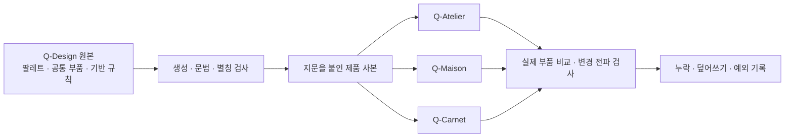

# Q 제품군 전체 디자인 규칙

대상은 아뜰리에, 메종, 카르넷의 화면 표현이다. 업무 판단식, 권한, 인증, 데이터 계산은 제품에서 관리한다. 디자인 원본은 Q-Design에서 관리하고 제품에는 검사 가능한 사본을 배포한다.

## 소유권과 변경 경로

| 층 | 원본 | 전달 방법 |
| --- | --- | --- |
| 팔레트·테마 | `patterns/palette-overrides.json`, `palette-mappings.json` | 제품별 CSS 변수 이름과 형식으로 생성 |
| 공통 조작부 | `patterns/components.css` | 세 제품에 동일 본문 복사 |
| 공통 기반 인자 | `patterns/foundation.css` | 제품별 기반 규칙 앞에 결합 |
| 배경·인증·셸·법적 안내·인쇄 | `patterns/foundation/*.css` | 원래 선택자와 미디어 순서를 보존해 제품별 생성 |
| 메종 유틸리티 | `patterns/foundation/maison-tailwind.ts` | TypeScript 사본을 Tailwind 설정이 가져옴 |
| 아뜰리에 인라인 스케일 | 제품 `lib/design/q-design-scale.ts` | 숫자가 필요한 업무 코드는 보존하고 UI 표현은 중앙 CSS 변수를 읽음 |
| 아뜰리에 JS·SVG 수치와 반응형 기준 | `source/design/atelier-runtime.ts` | 제품 수치 사본과 CSS 미디어 조건을 같은 설정에서 생성. 측정 좌표와 업무 계산은 보존 |
| 공통 업무 아이콘 | `patterns/react-icon.tsx`, `patterns/components.css` | 생성 모듈과 기본 크기·정렬 변수. 명시적 크기와 유틸리티 클래스 우선 |
| 아뜰리에 개별 표현 인자 | `patterns/foundation/atelier-values.css`, `atelier-core-values.css` | 안정적인 변수 이름으로 인라인 표현을 연결하고 변환 위치·기존 값 기록 |
| 카르넷 유틸리티 | `patterns/foundation/carnet-theme.css` | Tailwind 테마를 중앙 사본으로 가져와 공통 간격·서체·크기·반경을 읽음 |
| 메종 인쇄·문서 인자 | `patterns/foundation/maison-print.ts`, `maison-print-styles.tsx` | 물리 단위와 기존 기본값을 보존한 TypeScript 사본 |
| 카르넷 런타임 색상 | `dist/q-design.palette.carnet.ts` | PWA·회사 색상 대비 계산에서 같은 생성 팔레트를 사용 |
| 아뜰리에 오프라인 | `patterns/foundation/atelier-offline.html`, `patterns/foundation/offline.css` | CSS와 팔레트를 HTML 안에 묶고 내용 지문을 워커 캐시 판에 연결 |
| 공식 CI·바코드·인쇄 규격 | 승인된 자산과 해당 출력 계약 | 별도 경계로 기록하고 비율·기계 판독·물리 크기 보존 |

`build-foundation.mjs`는 공유 인자와 각 제품의 선택자 규칙을 합친다. `sync.mjs`는 본문 지문을 붙이고 정해진 제품에 복사한다. 파일이 존재하는 것과 실제 앱에서 읽는 것은 별도로 검사한다. 제품의 생성 사본을 직접 수정하지 않는다.



오프라인 화면은 서버 파일만 갱신해도 설치된 PWA의 캐시가 남을 수 있다. HTML 내용에서 만든 캐시 판 파일을 서비스 워커가 가져오고, 등록 시 `updateViaCache: 'none'`으로 워커와 가져온 파일의 변경을 확인한다. 해당 동작은 [MDN의 서비스 워커 캐시 갱신 설명](https://developer.mozilla.org/en-US/docs/Web/API/ServiceWorkerRegistration/updateViaCache)에 따른다.

## 인자별 필수 규칙

| 분야 | 반드시 관리할 인자 | 규칙 |
| --- | --- | --- |
| 화면 바탕 | canvas, surface, raised, 입력 면, 대비, 테마 초기값 | 의미 이름으로 연결하고 사용자 테마에 따라 같이 바뀐다. |
| 배경 장식 | 이미지, 리본, 색, 투명도, 폭, 위치, 흐림, 동작 시간, 이징 | 내용의 가독성을 우선한다. 장식은 입력을 가로채지 않고 동작 감소 설정을 따른다. |
| 제품 식별 | 공식 마크, 금속색, 비율, 보호 여백, 크기, 대체 텍스트 | 공식 자산을 유지한다. 제품색과 상태색의 역할을 섞지 않는다. |
| 서체 | UI·숫자·브랜드 계열, 폰트 로드, fallback, 크기, 굵기, 자간, 줄높이 | 일반 UI는 Pretendard, 식별 숫자는 공통 mono를 쓴다. 장식용 제목의 별도 서체는 지정된 위치에만 쓴다. |
| 밀도·간격 | 기준 단위, 내부 간격, 섹션 간격, 본문 여백, 행 높이 | 간격 스케일을 공유한다. 현장 입력 등 기능상의 차이는 명시적인 변형이다. |
| 레이아웃 | 너비, 최대폭, 최소폭, 열, 정렬, wrap, overflow, breakpoint | 모바일에서 읽기 순서를 유지하고 페이지 전체 가로 넘침을 만들지 않는다. 데이터 표의 내부 스크롤은 구분한다. |
| 인증 | 배경, 브랜드 영역, 폼 폭, 제목, 설명, 카드, 입력, 저장 계정, 행동, 테마 전환 | 로그인·가입·초대·비밀번호 찾기·재설정은 같은 인증 기반을 사용한다. |
| 앱 셸 | 머리 높이, 탐색 폭, 고정 오프셋, 본문 시작, 모바일 메뉴, 스크롤 여백 | 탐색과 제목이 본문을 가리지 않고 키보드 초점이 고정 영역 아래에 숨지 않는다. |
| 행동 | 크기, padding, radius, 레이블, 아이콘, hover, active, pending, disabled | 같은 역할의 행동은 같은 기본값을 사용한다. 누르는 영역은 일반 터치 44px 이상이다. |
| 입력 | 높이, 내부 간격, 글자 크기, placeholder, focus, 오류, 읽기 전용, disabled | 레이블과 설명을 연결한다. 카르넷 현장 입력은 56px 변형을 사용한다. |
| 선택 | checkbox, radio, switch, chip, select, calendar, 선택·비활성 상태 | 그림 크기와 누르는 영역을 분리한다. 상태는 색 이외에도 알 수 있어야 한다. |
| 목록·표 | 검색 띠, 필터, 열 제목, 셀 간격, 정렬, 선택, 빈 상태, 페이지 이동 | 제목·메타·숫자의 위계를 공유한다. 표 밀도와 조작부 높이를 함께 관리한다. |
| 카드·구역 | 제목, 설명, 면, 경계, 간격, 반경, 행동 위치 | 구역 구분에 필요한 면과 선만 사용한다. 같은 구조를 다른 그림자로 장식하지 않는다. |
| 오버레이 | 배경막, 표면, 경계, 반경, 폭, 여백, 층, 스크롤, 진입·퇴장 | 초점 진입·순환·복귀와 최상위 Escape 닫기를 보장한다. 긴 내용과 마지막 행동까지 도달할 수 있어야 한다. |
| 상태·피드백 | 안내, 오류, 성공, 토스트, badge, 진행률, skeleton | 의미 색을 공유하고 텍스트를 함께 둔다. 실패를 빈 데이터로 바꾸지 않는다. |
| 차트 | 시리즈, 축, 기준선, 점, 굵기, 투명도, 라벨, 범례 | 표현은 중앙 인자를 사용하고 좌표·값·집계·판정은 제품 계산을 유지한다. |
| 오류·접근 제한 | 오류 코드, 제목, 설명, 복구 행동, 최대폭, 배경 | 전역 오류, 404, 권한 없음, 오프라인은 같은 상태 화면 원칙을 따른다. 독립 HTML도 감사한다. |
| 동작 | 속성, 지속 시간, 지연, 반복, 이징, transform, reduced-motion | 정보를 이해하는 데 필요한 동작만 남긴다. 장식 움직임은 감소 설정에서 멈춘다. |
| 상호작용 | pointer, hover, focus-visible, selected, dragging, loading | CSS 상태와 실제 조작 상태를 맞춘다. CSS 값 검사만으로 동작을 통과시키지 않는다. |
| 레이어 | 고정 머리, 메뉴, 모달, tooltip, toast, blocking | 공통 층 순서를 지키고 중첩 오버레이의 닫기·스크롤 소유권을 구분한다. |
| 출력 | 용지, 여백, 글자, 경계, 페이지 나눔, 인쇄 테마, 바코드 | 화면 인자 변경으로 기계 판독과 법정 기록 양식이 변하지 않게 별도로 검증한다. |
| 자산·SVG | viewBox, fill, stroke, opacity, font, URL 이미지, 마스크 | CSS 색이 들어갈 수 없는 이미지 경계를 확인한다. SVG data URL이 외부 변수를 상속한다고 가정하지 않는다. |

상자 단추의 기본 높이는 44px이고 명시한 작은 변형은 데스크톱에서 36px다. 보조 글귀 행동은 데스크톱 36px, 터치 환경 44px를 사용한다. 아이콘만 있는 행동은 44px다. 카르넷 현장 입력과 주요 현장 행동의 56px는 별도로 이름 붙인 작업용 변형이다. 제품 이름만으로 같은 역할의 기본 크기가 달라지지 않게 한다.

## 감사의 판정

`style-arguments.mjs`는 코드, CSS, 내장 CSS, 인라인 객체, 클래스 식, SVG 표현, DOM 스타일 변경, public HTML/SVG와 설정 파일을 읽는다. 자료 객체의 `width`처럼 CSS와 같은 이름의 값도 후보로 기록하므로 발견 수를 컴포넌트 수로 해석하면 안 된다.

이름 붙은 스타일 기본값과 변수도 기록한다. 클래스 목록은 유틸리티별로 나눈다. 한 항목이 변수를 참조해도 옆에 있는 직접 수치는 별도 검토 대상으로 남는다. JSX의 SVG 서체 속성과 React의 접두어 속성도 기록한다. 다만 정적 분석만으로 동적 클래스, 실행 조건, 데이터 좌표, 모든 CSS 우선순위를 증명할 수는 없다.

- `central-source`: 배포 목록으로 원본을 확인할 수 있는 중앙 사본의 인자.
- `token-reference`: 공통 변수나 어댑터를 참조하는 값. 참조가 있다는 것만으로 올바른 역할과 실제 반영을 증명하지 않는다.
- `structural-literal`: 레이아웃 동작에 관한 고정 키워드. 제품 구조 검토 대상이다.
- `asset-or-data-boundary`: 자산 또는 데이터 좌표 경계. 자동 면제가 아니다.
- `review-required`: 직접 적힌 값, 동적 식, 불명확한 객체, 클래스 조합 또는 분석 실패. 목록을 다시 생성해도 완료로 바뀌지 않는다.

새 파일과 인자는 파일 지문과 근거 목록에 나타난다. `--check`는 감사 근거가 현재 코드와 일치하는지 확인한다. `--strict`는 미검토 항목이 남으면 실패한다. 전체 화면을 보지도 않고 인벤토리만으로 모든 디자인이 완료됐다고 표시하지 않는다.

## 확인 명령

```powershell
node tools/build-foundation.mjs
node tools/sync.mjs --write --only=Q-Atelier,Q-Works,Q-Forge
node tools/component-registry.mjs --write
node tools/style-arguments.mjs --write
node tools/check-components.mjs
node tools/style-arguments.mjs --check
node tools/build-component-workbench.mjs
node tools/verify-component-workbench.mjs
node tools/verify-foundation-workbench.mjs
```

전체 추출은 커밋된 아뜰리에 원본을 사용한다. 엔진 지문에 포함된 원본 토큰, 엔진 증빙과 잠금 파일은 UI 변경을 위해 수정하지 않는다. 원본 추출·제품 사본·화면 검사·전체 릴리스 검사 결과를 구분해 기록한다.
